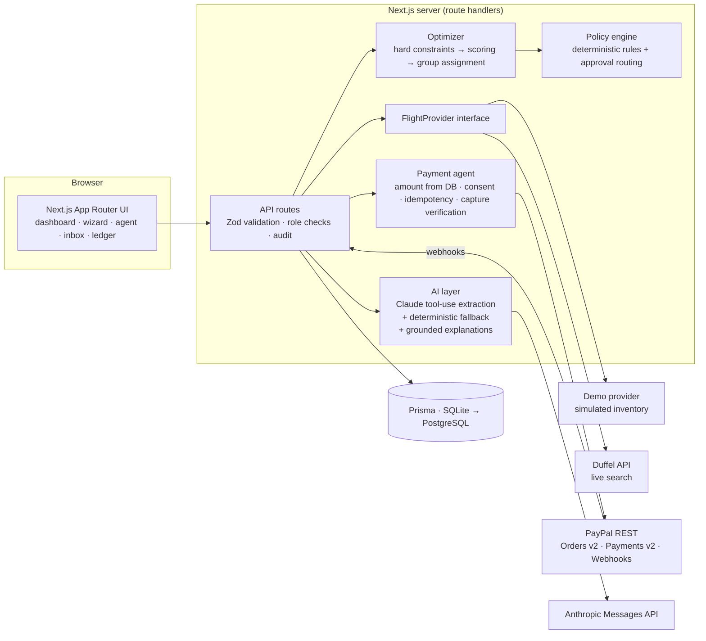
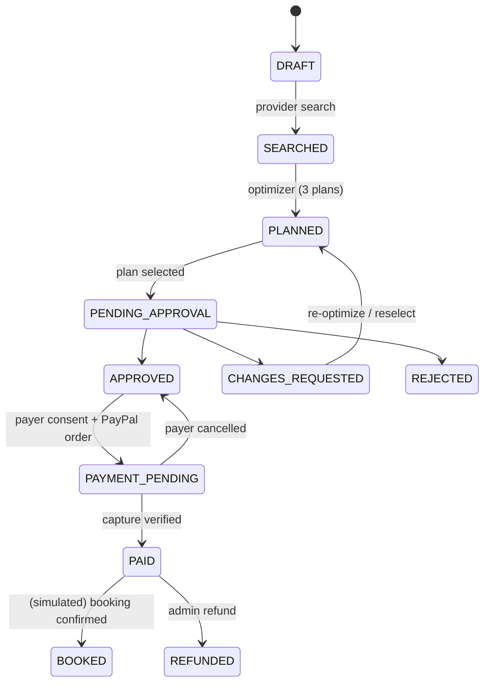

# TripPilot Business

**Your AI agent for smarter corporate travel and payments.**

TripPilot Business is an AI-powered corporate travel procurement platform for small and mid-sized companies (20–500 employees), starting with Saudi domestic routes (RUH ↔ JED ↔ MED). A travel manager describes a trip in one sentence. TripPilot extracts the constraints, searches flights, runs a constraint-safe group optimizer, checks every itinerary against company policy, routes the purchase to the right approver, and executes the approved payment through **PayPal**. It tracks payment status and booking status separately.

> *One instruction. Multiple employees. Optimized travel. Policy-compliant decisions. Approved PayPal payments.*

---

## 1. Product overview

| Problem | TripPilot |
|---|---|
| Collecting requests from many employees | Request wizard + natural-language agent; employee profiles hold baggage, timing and airline preferences |
| Comparing many flights across dates | Provider abstraction + flight table showing *why* each flight is eligible or rejected |
| Coordinating 10 people on one trip | Capacity-aware group optimizer producing **Cheapest**, **Best balance** and **Most convenient** plans |
| Policy compliance | Deterministic policy engine: `COMPLIANT` / `REQUIRES_APPROVAL` / `POLICY_VIOLATION`, with actual value, allowed value and recommendation |
| Approvals | Threshold-based routing (travel manager → department head → executive), inbox with full context, audit trail |
| Payment | Server-side PayPal Orders v2 create → payer approval → capture → verification, idempotent and duplicate-safe |
| Spend tracking | Ledger with filters, transaction detail with PayPal ids and event history, refunds, analytics |

## 2. Features

- **Executive dashboard**: KPIs (spend, trips, active requests, pending approvals, estimated savings, PayPal success rate), current plan banner, and charts for monthly spend, department, destination, compliance and budget utilisation. Every number is computed from the database.
- **Employee management**: directory, add/edit/deactivate, all-or-nothing CSV import with per-row validation errors.
- **Travel requests**: a 4-step wizard (individual or group, multiple candidate dates, time windows, budgets, airlines, baggage, direct-only, flexible dates).
- **AI Travel Agent**: a conversational panel that turns an instruction into a validated structured request, shown for review, then creates it and runs search + optimization automatically.
- **Flight provider architecture**: a `FlightProvider` interface with a clearly labelled **Demo provider** and a **Duffel** adapter (live search).
- **Optimization engine**: hard-constraint filtering, normalised weighted scoring (weights editable in Policies), seat-capacity-aware group assignment, unsatisfiable-traveler detection, budget exceptions, savings against a median-fare baseline.
- **Policy engine**: grade limits, personal limits, cabin classes, advance booking, preferred airlines, direct preference, approval thresholds, department budget escalation.
- **Payment & approval agent**: approval inbox (approve / reject / request changes, with reasons). Explicit payer consent is a separate step. PayPal Sandbox checkout, capture verification, refunds, webhook receiver.
- **Transaction ledger**: filters (date, department, employee, status, currency), totals by department / employee / request, and a detail page with the full payment event history.
- **Price monitoring**: watch a fare with a target price, refresh, and get an in-app notification when the target is hit (simulated drift for demo inventory, clearly labelled).
- **Notifications and audit log** for every important state transition.

## 3. Architecture



**Lifecycle.** Payment and booking are separate state machines:



**Key design decisions**

- **The AI never decides money.** Claude only extracts structure (validated by Zod) and rephrases explanations. Any generated explanation containing a number that does not come from the plan data is discarded (`numbersAreGrounded`). Policy, optimization, amounts and approvals are deterministic code.
- **Integer money everywhere.** All amounts are stored as integer minor units (`Int` halalas/cents). FX conversion uses integer half-up rounding per line, so the PayPal total always equals the sum of its items.
- **Hard constraints are filters, not penalties.** Arrival deadline, time windows, direct-only, required baggage, allowed cabin and seats are removed before scoring. The request's per-employee cap is hard too. When *no* in-cap option exists for a traveler, the cheapest compatible option is surfaced as an explicit **budget exception** that requires approval. It is never silently accepted.
- **Approval ≠ payment authorisation.** Approving a plan does not charge anything. The payer must tick an explicit consent for the exact server-computed amount, and that consent is stored on the payment record (`consentById`, `consentAt`).

## 4. Technology stack

Next.js 15 (App Router) · React 19 · TypeScript · Tailwind CSS v4 · hand-written shadcn-style primitives (`src/components/ui.tsx`) · Lucide icons · Recharts · Prisma 6 + SQLite · Zod · Anthropic Messages API (fetch, no SDK lock-in) · PayPal REST (fetch) · Vitest.

## 5. Installation

Requires Node.js ≥ 20.

```bash
cd trippilot-business
cp .env.example .env        # then fill in PayPal Sandbox credentials
npm install                 # runs prisma generate
npm run setup               # apply migrations to a new SQLite DB + seed Northstar Consulting
npm run dev                 # http://localhost:3000
```

> On npm 11+ with install-script restrictions, run `npx prisma generate` once if the client is missing.

## 6. Environment variables

| Variable | Required | Purpose |
|---|---|---|
| `DATABASE_URL` | yes | `file:./dev.db` (SQLite) |
| `NEXT_PUBLIC_APP_URL` | yes | Base URL used for PayPal return/cancel URLs |
| `PAYPAL_CLIENT_ID` / `PAYPAL_CLIENT_SECRET` | for payments | PayPal Sandbox REST app credentials (server-only) |
| `PAYPAL_BASE_URL` | yes | `https://api-m.sandbox.paypal.com` |
| `PAYPAL_CHARGE_CURRENCY` | yes | `USD` (see currency note below) |
| `PAYPAL_WEBHOOK_ID` | optional | Enables webhook signature verification |
| `PAYPAL_HTTP_TIMEOUT_MS` | optional | Timeout for each PayPal HTTP call (default 30000). A timed-out capture becomes `CAPTURE_UNKNOWN`, never `FAILED` |
| `ANTHROPIC_API_KEY` / `ANTHROPIC_MODEL` | optional | Claude extraction + explanations; deterministic fallback otherwise |
| `FLIGHT_PROVIDER` | optional | `DEMO` (default) or `DUFFEL` |
| `DUFFEL_ACCESS_TOKEN` | optional | Duffel test/live token for live search |

Secrets are read only in server modules marked `import "server-only"`. Nothing is exposed via `NEXT_PUBLIC_*` except the app URL.

## 7. Database setup

```bash
npm run db:migrate  # apply pending migrations (prisma migrate deploy)
npm run db:seed     # deterministic demo data
npm run db:reset    # drop + re-apply all migrations + seed (also: Settings → Reset demo database, admin only)
```

The schema is managed with **Prisma Migrate** (`prisma/migrations/`). A `dev.db` created by an older build with `db push` has no migration history and lacks the payment-safety columns: run `npm run db:reset` once (it deletes local demo data and reseeds it).

Models: Company, Department, User, Employee, TravelPolicy, TravelRequest, Traveler, FlightOption, Itinerary, ItineraryAssignment, Approval, Payment, PaymentEvent, Booking, PriceAlert, Notification, AuditLog. To move to PostgreSQL, change `provider = "postgresql"` and `DATABASE_URL`. Enumerations are stored as strings and validated with Zod, so no SQLite-specific features are used.

## 8. Demo accounts

Authentication is a **demo account selector** in the header (a cookie, no passwords). It is clearly labelled "Demo login" and must be replaced with SSO before production. Role checks are enforced server-side on every route.

| Account | Role | Can do |
|---|---|---|
| Omar Al-Rashid | Travel manager (level 1) | Create requests, run the agent, select plans, approve ≤ SAR 1,200/employee, authorise payment |
| Faisal Al-Mutairi | Department head (level 2) | Approve ≤ SAR 2,000/employee and group totals above SAR 10,000 |
| Layla Al-Harbi | Admin / CFO (level 3) | Everything: policy, employees, executive approvals, refunds, demo reset |
| Noura Al-Shehri | Employee | Request own travel, see own trips and statuses |

## 9. PayPal Sandbox setup

1. Sign in at <https://developer.paypal.com> → **Apps & Credentials** → *Sandbox* → **Create App** (Merchant). Copy the Client ID and Secret into `.env`.
2. Under **Testing Tools → Sandbox Accounts**, use the auto-created **Personal** (buyer) account to approve payments.
3. (Optional) Add a webhook pointing at `https://<public-url>/api/paypal/webhook` for `PAYMENT.CAPTURE.COMPLETED`, `PAYMENT.CAPTURE.DENIED`, `PAYMENT.CAPTURE.REFUNDED` and `PAYMENT.CAPTURE.REVERSED`, then set `PAYPAL_WEBHOOK_ID`. Locally, use a tunnel (e.g. ngrok) for webhooks. Return-URL capture works without one.
4. Restart `npm run dev`. **Settings** shows "PayPal: Active (Sandbox)".

**How the integration works** (`src/lib/payments/paypal.ts`, `src/lib/services/payments.ts`):

1. `GET /api/requests/:id/checkout` recomputes the amount from the stored itinerary lines.
2. The payer ticks consent → `POST /api/requests/:id/checkout` re-validates: role, request status, an `APPROVED` approval whose amount equals the current amount, the consent amount equals the server amount, and the request is not already paid. Any open order for the same plan and amount is **reused**, and checkout is refused while an earlier payment is `CAPTURING`, `CAPTURE_UNKNOWN`, `NEEDS_REVIEW`, `CAPTURE_PENDING` or `CAPTURED`.
3. A `Payment` row is created first. It takes the request's **payment slot**: `Payment.activeLock = requestId` under a UNIQUE index, inserted in one transaction with the request's move to `PAYMENT_PENDING`, so two simultaneous checkouts cannot both create PayPal orders. Then then `POST /v2/checkout/orders` with `intent: CAPTURE`, a `PayPal-Request-Id` idempotency key, per-employee items, `reference_id` = payment id and return/cancel URLs.
4. The payer approves on PayPal and is redirected to `/checkout/return`, which calls `POST /api/payments/:id/capture`.
5. The capture takes a compare-and-set DB lock (`CAPTURING`), calls `/capture` with a per-attempt idempotency key, handles `ORDER_ALREADY_CAPTURED`, and **verifies** order id, reference id, currency and exact amount.
6. Only a verified `COMPLETED` capture marks the payment `CAPTURED`, moves the request to `PAID` and creates simulated holds. A `PENDING` capture stays `CAPTURE_PENDING` (not paid). Every step writes a `PaymentEvent`.

**When the outcome is uncertain** (P0 safety):

| Situation | Payment status | Request | New checkout |
|---|---|---|---|
| Capture timed out, network failed, or PayPal returned a non-JSON / 5xx response | `CAPTURE_UNKNOWN` (order id kept, error evidence stored) | stays `PAYMENT_PENDING` | blocked |
| PayPal returned a capture that fails verification (amount, currency, reference, order id) | `NEEDS_REVIEW` (all PayPal ids + evidence stored, shown on the transaction page) | stays `PAYMENT_PENDING` | blocked |
| Process died mid-capture | `CAPTURING` | stays `PAYMENT_PENDING` | blocked |

**Reconcile with PayPal** (`POST /api/payments/:id/reconcile`, button on the transaction page) reads the order from PayPal and acts on its real state: `COMPLETED` → verify and record; `APPROVED` → capture now; not approved → back to awaiting the payer; `VOIDED`/declined → `FAILED` and the slot is released. It never treats elapsed time as failure. A `CAPTURING` payment younger than 60 s is left alone. If PayPal can't be reached, nothing changes. `NEEDS_REVIEW` is only cleared by a clean verification; otherwise a person decides.
7. Admins can refund via `POST /v2/payments/captures/:id/refund`. Simulated bookings are cancelled with it.

**Currency.** PayPal's REST currency list (developer.paypal.com/reference/currency-codes) **does not include SAR**. TripPilot keeps every business amount in SAR and charges PayPal in **USD at the fixed 3.75 SAR/USD peg**, showing both figures to the payer before consent. If `PAYPAL_CHARGE_CURRENCY` is set to a currency PayPal does not support, checkout is refused with an error. It is never sent silently.

**Merchant relationship.** PayPal Checkout is buyer → merchant. In this MVP the company (buyer) pays **TripPilot's sandbox merchant account**, which models TripPilot acting as the travel agency of record. TripPilot does **not** pay airlines through PayPal. Supplier settlement (e.g. a Duffel balance) is a separate integration. A captured PayPal payment never marks a ticket as issued.

## 10. Flight provider setup

Research summary (as of Nov 2026):

| Provider | Registration / sandbox | Booking & ticketing | Payment | Notes |
|---|---|---|---|---|
| **Amadeus Self-Service** | **Decommissioned 17 July 2026** (new sign-ups paused March 2026; keys disabled) | — | — | Only Amadeus Enterprise remains (contracted). Not usable for this MVP. |
| **Duffel** | Self-serve signup; test mode with a sandbox airline | Orders/ticketing via Duffel; live mode requires account verification | Settled from Duffel balance/card — **not PayPal** | Content coverage for Saudi carriers varies by airline/NDC; verify before relying on it |
| Others (Kiwi Tequila, Travelport, Sabre) | Partner/contract access | Varies | Varies | Out of scope for a hackathon MVP |

Implementation:

- `src/lib/providers/types.ts`: the `FlightProvider` interface (`searchFlights`, `getFlightDetails`, `priceFlight`, `createBooking`, `getBookingStatus`, `cancelBooking`) plus declared capabilities.
- `src/lib/providers/demo.ts`: the **Demo provider** (default). Deterministic schedules with weekday fare variation, seat counts, baggage, cabins, simulated fare drift and a simulated reservation lifecycle. Every result is `isDemo = true` and shown with "Demo inventory" labels. Booking references use a `SIM-XXXXXXXX` format that deliberately does not look like an airline PNR.
- `src/lib/providers/duffel.ts`: live **search and re-pricing** with `FLIGHT_PROVIDER=DUFFEL` + `DUFFEL_ACCESS_TOKEN`. Booking is intentionally disabled (it throws) until Duffel order + payment is implemented, so no code path can claim a ticket.

## 11. Running

```bash
npm run dev          # development
npm run build && npm start
npm test             # unit tests (optimizer, policy, money, parser, PayPal client)
npm run typecheck
node scripts/smoke.mjs   # end-to-end API smoke test against a running dev server
```

## 12. Demo walkthrough (≈3 minutes)

1. **Overview** as *Omar (travel manager)*: KPIs, charts, and the seeded request *TR-1014 · Jeddah client workshop* (10 employees, RUH→JED 15 Mar, return 16 Mar).
2. **AI Travel Agent** → *Example 1* → **Plan this trip**. The agent extracts route, dates, "arrive before 10:00", "return after 17:00", the budget and direct-only. Review the 4-step form (travelers pre-selected) → **Create request**.
3. The workspace runs **search + optimization** automatically. Show:
   - flight table: SV 1001 (business cabin), SV 1301 (1 stop), XY 2014 (arrives 10:15), XY 2027 (departs 15:30) and SV 1047 (lands after midnight) are **rejected with reasons**;
   - three plans (cheapest ≈ SAR 9,377, balanced ≈ SAR 9,567, convenient ≈ SAR 9,533), all under the SAR 15,000 budget with savings against baseline;
   - per-employee table: **Khalid** can't depart before 07:00 and needs a checked bag, so his cheapest option is SAR 1,262 → *REQUIRES_APPROVAL, +SAR 62*.
4. **Select & submit** the recommended plan → it is routed to the **Department head** (Khalid's exception). Payment is blocked.
5. Switch account to **Faisal** → **Approvals**: prices, policy, department budget remaining, AI explanation → **Approve purchase**.
6. Switch back to **Omar** → the request shows the SAR→USD breakdown → tick consent → **Continue to PayPal** → log in with the Sandbox buyer → **Pay**.
7. Back on `/checkout/return` the server **captures and verifies** the payment. Open the transaction: order id, capture id, consent and event history.
8. The request shows **Payment: Captured** while **Booking: Simulated held** stays separate → **Confirm simulated booking**. The dashboard spend, trips and PayPal success rate update.
9. (Optional) As **Layla**: **Refund via PayPal** on the transaction; edit **Policies** weights/thresholds and re-optimize.

## 13. API limitations

- PayPal REST does not support SAR, so charges are in USD at the peg. Only USD conversion is implemented.
- PayPal Checkout cannot pay airlines directly. Supplier settlement is a separate integration.
- Amadeus Self-Service no longer exists. Duffel booking is not enabled in this MVP.
- Webhooks need a public URL and `PAYPAL_WEBHOOK_ID`. Without them, status comes from the verified return-URL capture plus the manual "Reconcile with PayPal" action.

## 14. Known limitations

- Demo authentication (cookie-based account switcher). Not secure for production.
- Flight inventory is **simulated** unless Duffel is configured. Fares, seats and schedules are not real.
- Bookings are **simulated holds/confirmations**. No airline PNRs or e-tickets are created.
- The group optimizer is a greedy, most-constrained-first heuristic with cohesion bonuses. It is not a proven global optimum for large groups.
- Traveler home airports other than the request origin are not routed separately.
- Price alerts refresh on demand (button), not on a background schedule.
- Only full refunds are exposed in the UI.

## 15. Roadmap

- SSO (Azure AD / Google Workspace) and real RBAC administration.
- Duffel order creation + ticketing, and hotel/ground transport providers.
- PayPal vaulting / Payouts for supplier settlement, and partial refunds.
- MILP-based group optimizer, multi-origin travelers, and multi-city trips.
- Scheduled price monitoring and Slack/Teams approval actions.
- ZATCA e-invoicing and expense-system exports.

---

Licensed under the MIT License. Sandbox payments are not real purchases. Simulated flights are not real airline inventory.
